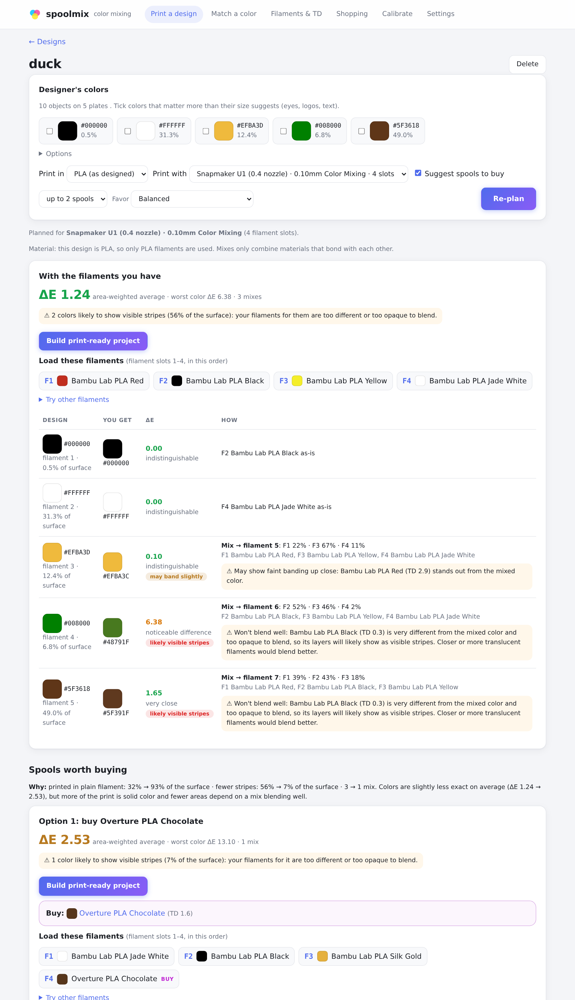
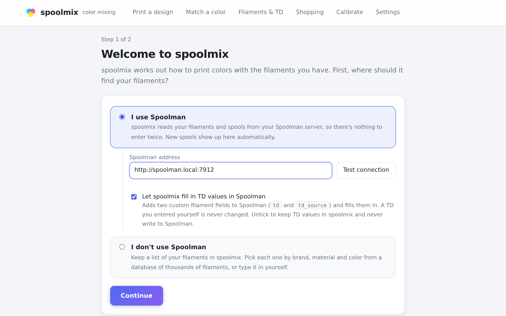
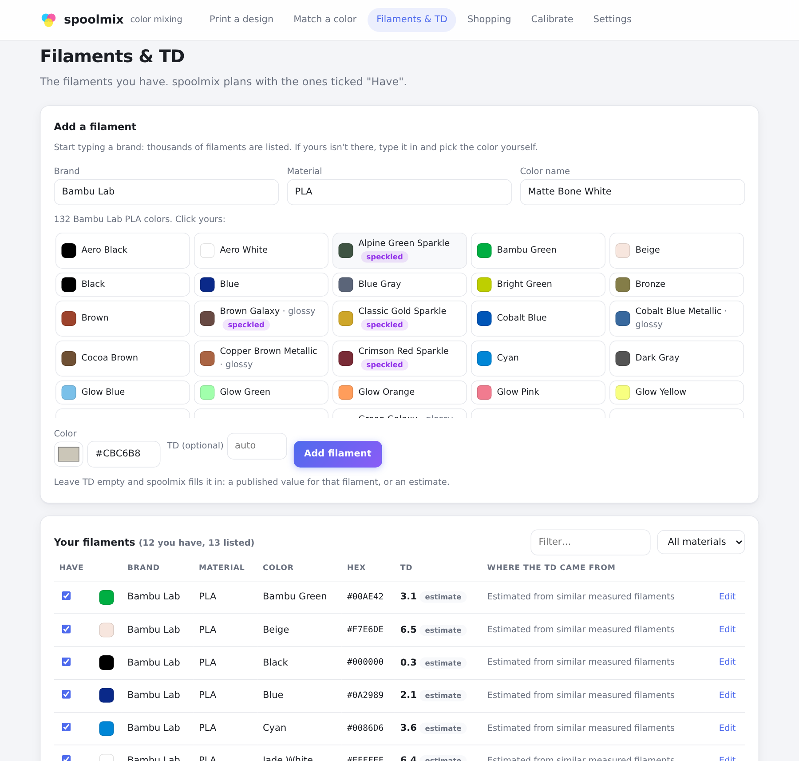
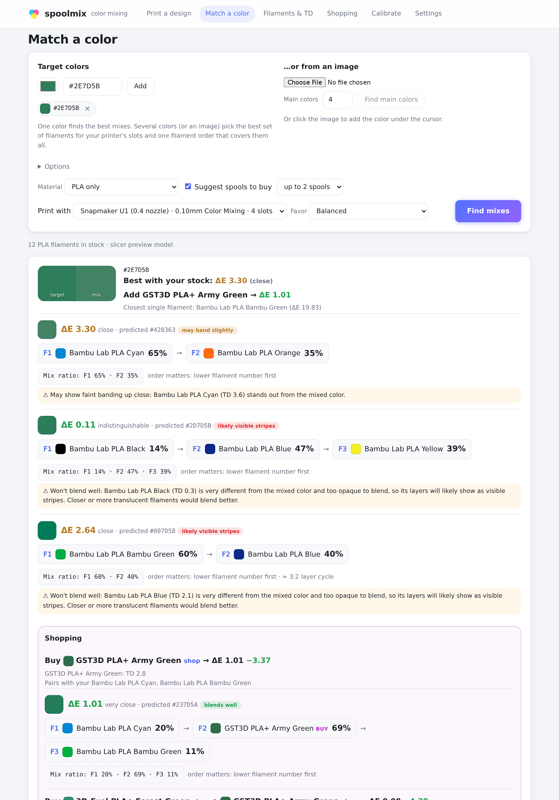

# spoolmix

**Full Spectrum isn't limited to CMY: plan color-mixing prints with the best filaments from your whole inventory.**

Printers like the Snapmaker U1 mix colors by stacking very thin layers of different
filaments ("Full Spectrum" color mixing). Most people mix only the cyan, magenta and yellow
starter set, but the spools you already own (black, brown, gold, green…) are often a better
base for a model's colors than any CMY mix: fewer mixes, less striping, closer colors.
Working out *which* spools to load and *what ratios* to use across a whole inventory is
fiddly, so spoolmix does it for you:

- Drop in a multicolor 3MF (a model you designed or downloaded) and it tells you which
  filaments to load, mixes the colors you don't have, and builds a print-ready project.
- On **Match a color**, pick any color (or click one in a photo) and get mix recipes you can
  type into your slicer.
- When a spool or two would make a real difference, it tells you which ones to buy, and when
  it's simpler to just buy the missing color, it says so.

It runs as a small web app on your own computer or home server, in Docker.

<picture>
  <source media="(prefers-color-scheme: dark)" srcset="docs/images/design-plan-dark.png">
  
</picture>

## Features

- **Print a design.** Import a multicolor 3MF project. spoolmix reads the designer's colors
  and how much of the model each one covers, picks the best filaments for your printer's
  slots, and fills in the rest with mixes. Download a ready-to-print project with every
  mix already set up and applied.
- **Honest about stripes.** Mixing an opaque filament (like regular black PLA) into a light
  color prints as visible stripes, not a smooth blend. spoolmix knows each filament's
  translucency and prefers plain filaments and well-blending mixes over "mathematically
  closer" ones you'd see stripes in. You choose the trade-off: balanced, smooth blends,
  or exact colors.
- **Shopping suggestions from thousands of filaments.** Searches every single-color filament
  in the open [SpoolmanDB](https://github.com/Donkie/SpoolmanDB) database and only suggests
  a spool when it clearly helps, one per color family.
- **Never mixes incompatible materials.** PLA stays with PLA; PETG with PETG-friendly
  materials.
- **Translucency (TD) filled in automatically.** Published values where they exist
  (manufacturers, [filamentcolors.xyz](https://filamentcolors.xyz/)), otherwise clearly
  labeled estimates. You never have to measure anything.
- **Works with [Spoolman](https://github.com/Donkie/Spoolman), or on its own.** Use your
  Spoolman inventory, or keep a simple filament list in spoolmix, added by brand,
  material and color from the database.
- **Calibration (optional).** Print a grid of small labelled blocks, photograph their side
  walls, and fit the predictions to your own printer and filaments.

## What you need

- **Docker** (Docker Desktop on Windows/macOS, or Docker Engine on Linux). Works on
  x86-64 and ARM64, including a Raspberry Pi 4/5.
- **A color-mixing printer and slicer** to print the results. spoolmix reproduces the
  layer-based color mixing in [Snapmaker Orca](https://github.com/Snapmaker/OrcaSlicer),
  and the print-ready projects it builds use that slicer's mixed-filament format.
  Color matching, shopping suggestions and filament management work with any setup.
- **Spoolman is optional.**

## Install

### Docker Compose (recommended)

Make a folder for spoolmix, download [`compose.yaml`](compose.yaml) into it, and start it:

```bash
mkdir spoolmix && cd spoolmix
```

```bash
curl -fsSLO https://raw.githubusercontent.com/lombarke/spoolmix/main/compose.yaml
```

```bash
docker compose up -d
```

Then open **http://localhost:8790** (or `http://<server-name>:8790` from another device).

The compose file is short. The parts you might change:

```yaml
services:
  spoolmix:
    image: ghcr.io/lombarke/spoolmix:latest
    container_name: spoolmix
    restart: unless-stopped
    ports:
      - "8790:8790"            # change the left number to use another port
    environment:
      PUID: "1000"             # files in ./data are owned by this user/group
      PGID: "1000"
      # SPOOLMAN_URL: "http://spoolman.local:7912"   # optional
    volumes:
      - ./data:/data           # everything spoolmix saves; back this folder up
```

### Docker run

```bash
docker run -d --name spoolmix --restart unless-stopped -p 8790:8790 -v "$PWD/spoolmix-data:/data" ghcr.io/lombarke/spoolmix:latest
```

### Updating

```bash
docker compose pull && docker compose up -d
```

Your data in `./data` is kept. Image tags: `latest` follows the main branch; version tags
like `0.2.1` are available for pinning.

### Settings

| Environment variable | Default | What it does |
|---|---|---|
| `PUID` / `PGID` | `1000` | User and group that own the files in `./data` (run `id` on the host to see yours) |
| `SPOOLMAN_URL` | none | Your Spoolman address. Optional: you can choose it on the setup page instead |
| `SPOOLMIX_AUTO_TD` | `1` | Set to `0` to stop the background TD and database refresh (every 6 hours) |

Everything else is set in the web UI under **Settings**.

### Building from source

```bash
git clone https://github.com/lombarke/spoolmix.git && cd spoolmix && docker build -t spoolmix .
```

Then use `image: spoolmix` in the compose file.

## Getting started

### 1. Tell spoolmix where your filaments are

The first time you open it, spoolmix asks:

- **I use Spoolman:** enter your Spoolman address and press *Test connection*. With
  *Let spoolmix fill in TD values in Spoolman* ticked, it adds two custom filament fields
  (`td`, `td_source`) to Spoolman and fills them in. It never changes a TD you entered
  yourself. Untick it and spoolmix never writes to Spoolman at all.
- **I don't use Spoolman:** you'll keep a filament list in spoolmix instead (next step).



### 2. Add your filaments (without Spoolman)

On **Filaments & TD**, add each filament you own, the same way Spoolman's add form works:
type a brand, pick the material, then click your color from that brand's swatches. Name,
color and material fill in, and the TD is looked up automatically. Anything not in the
database can be typed in with a color picker. Untick **Have** when you run out of something.



### 3. Add your printer template

spoolmix builds print-ready projects with your printer's own settings, which it copies from
a small project you save once in your slicer. The setup asks for it right after step 1, and
it's under **Settings → Printer templates** any time:

1. In your slicer, pick your printer and nozzle and its **color-mixing print process**.
2. Set up **one filament per slot** your printer has, with the filament presets you normally
   use. The colors don't matter; spoolmix fills them in.
3. Put any small object on the plate, **save the project** as a `.3mf`, and upload it.

spoolmix shows what it read (printer, process, layer height, filament slots) and warns you
about settings that affect its predictions. Replace it whenever you change presets.

You can keep **several templates**: one per printer, nozzle or process (say 0.10 mm and
0.20 mm, or Subdivide Mix Layer on and off). Each design and color match is planned for the
one you pick under **Print with**, which also sets the number of filament slots. If a
template's filament presets don't match the design's material (a PETG template for a PLA
design), spoolmix tells you. Calibration is kept per template.

### 4. Print a design

Drag a multicolor 3MF onto the home page. spoolmix shows the designer's colors and how much
of the model each covers. Pick the printer template under **Print with** (or, without a template, set how many
filament slots your printer has), tick any small but important colors (eyes, logos), and press **Plan**. You get:

- **With the filaments you have:** what to load in which slot, and for each design color
  whether it's printed as-is or mixed (with the ratio).
- **Spools worth buying** (if any), with the reason, e.g. *"fewer stripes: 56% → 7% of the
  surface"*, or *"Simplest: buy a brown and skip color mixing"*.
- **Try other filaments** on any plan: pick a different filament for a slot (say your red
  instead of the magenta), and spoolmix shows **Your version** next to it, with how the
  colors, stripes and mixes change. Build it like any other plan, or discard it.
- **Build print-ready project** downloads a `.3mf` with your filaments in slots 1, 2, …,
  each mix defined as an extra filament, and every part and painted area pointed at the
  right one. Open it in your slicer, load the listed filaments, slice, print.

The design's material comes from the designer, but you can **Print in** another one you have
filament in (a PETG model in PLA, say). spoolmix offers this when your printer template is set
up for a different material and you have more filament in it.

### 5. Match a single color

**Match a color** takes a color (or several, or a photo you click on) and gives the best
mixes with your filaments, how they'll blend, and what to buy for a closer match.



## Good to know

- **Predictions are approximate.** spoolmix predicts colors exactly the way the slicer's
  color-mixing preview does. That preview is a model, not a measurement of your printer,
  filament batch or lighting. Treat ΔE below 2 as "very close on screen" (ΔE is the
  standard measure of color difference; below about 1 is invisible). Calibration narrows
  the gap.
- **Layered mixing can't make true black,** and cyan/magenta/yellow can't make dark colors.
  Dark designs need dark filament.
- **Subdivide Mix Layer** (a slicer option) makes painted mixes very smooth, but in test
  prints the mix ratio then barely mattered: every ratio came out close to one in-between
  color. spoolmix warns you when a printer template has it on. See
  [how it works](docs/how-it-works.md#subdivide-mix-layers).
- **Translucent filaments blend best.** Filaments made for color mixing (TD 5–10) blend
  smoothly; opaque ones (TD under 2) tend to stripe. spoolmix accounts for this and warns
  you.
- **Privacy:** spoolmix runs entirely on your machine. It only connects out to download
  public data: SpoolmanDB (weekly), and published TD tables from Snapmaker, Prusa and
  filamentcolors.xyz (weekly, for the brands you own). No accounts, no telemetry.
- **There's no login.** Like Spoolman, spoolmix is meant for your home network: anyone who
  can reach it can use it and change its settings. Don't expose it to the internet as is; if
  you want it reachable from outside, put it behind a reverse proxy that adds authentication.
- **"Insecure download" warnings:** browsers flag files downloaded over plain `http://`, so
  the print-ready `.3mf` may need a click on *Keep*. That's safe on your own network. To make
  it go away, serve spoolmix over HTTPS through a reverse proxy (Nginx Proxy Manager, Caddy,
  Traefik…), as for any self-hosted app.

## Tested with

- Snapmaker U1 with Snapmaker Orca 2.4, printing PLA and PLA+ (PETG designs planned and built)
- Spoolman 0.27, and the built-in filament list without Spoolman
- Docker on x86-64 Linux (a Proxmox LXC), installed with Docker Compose and Dockge
- ARM64 images (e.g. Raspberry Pi) are built and published but not yet tested on hardware

Using it with another printer, slicer or material? Feedback in
[issues](https://github.com/lombarke/spoolmix/issues) is very welcome.

## How it works

The short version: spoolmix reimplements the slicer's color-mixing math (a polynomial
pigment-mixing model, mixed pairwise in filament order), scores colors with CIEDE2000,
estimates striping from each filament's translucency, and searches every combination of
filaments, slot order and ratio for the plan with the least *visible* error.

[docs/how-it-works.md](docs/how-it-works.md) covers it in detail: the mixing model, the
striping score, TD sources and estimates, material compatibility, how purchases are
chosen, calibration, and how to customize the shopping list.

## Development

```bash
git clone https://github.com/lombarke/spoolmix.git && cd spoolmix
```

```bash
uv sync && uv run pytest
```

```bash
uv run uvicorn spoolmix.web.app:app --reload --port 8790
```

Requires [uv](https://docs.astral.sh/uv/). The web UI is FastAPI with server-rendered
templates and a little vanilla JavaScript, so there's no build step. Tests cover the
slicer's golden mixer values, the CIEDE2000 reference pairs, the planner, 3MF painting
round-trips, and the web pages.

`tests/test_browser.py` clicks through the whole UI in headless Chrome (setup, adding
filaments, planning and building a design, matching a color) and fails on any JavaScript
error or failed request. It's skipped unless the browser is installed:

```bash
uv run playwright install --with-deps chromium
```

CI runs it on every push.

## Credits and license

- **[FilamentMixer](https://github.com/justinh-rahb/filament-mixer)** by Justin Hayes
  (MIT): the polynomial mixing coefficients, the same ones Snapmaker Orca ships.
- **[Snapmaker Orca](https://github.com/Snapmaker/OrcaSlicer)** (AGPL-3.0) was studied to
  reproduce its color prediction. No AGPL code is included; spoolmix is an independent
  reimplementation.
- **[Spoolman](https://github.com/Donkie/Spoolman) and
  [SpoolmanDB](https://github.com/Donkie/SpoolmanDB)** by Donkie.
- TD data from Snapmaker, Prusa Research and
  [filamentcolors.xyz](https://filamentcolors.xyz/), cited per entry.

spoolmix is MIT licensed. See [LICENSE](LICENSE) and [NOTICE](NOTICE).
